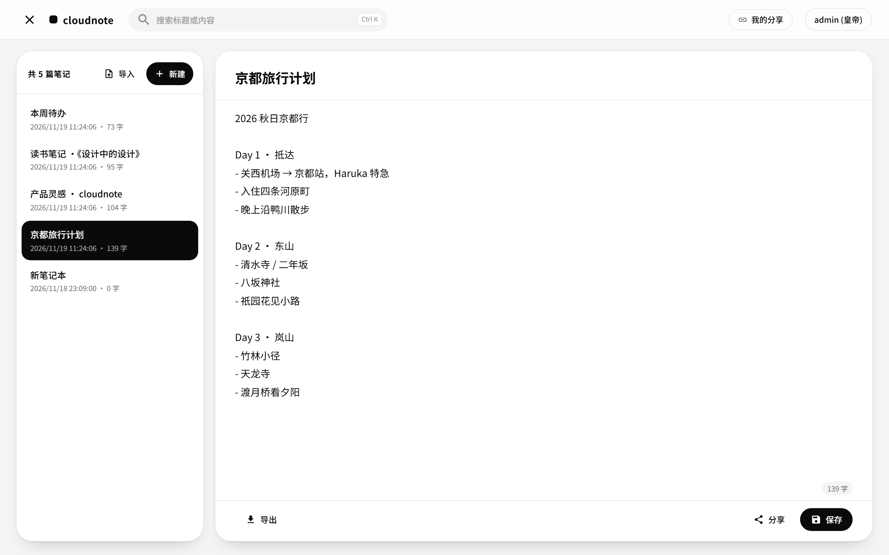
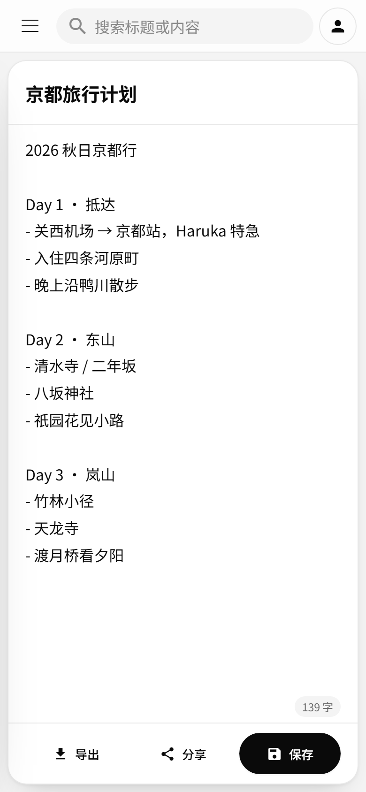

# cloudnote

基于 **Cloudflare Workers + D1** 的在线记事本。黑白极简界面，支持笔记管理、全文搜索、TXT 导入/导出、公开分享链接、注册图片验证码和皇帝管理员面板。

- 前端：原生 HTML / CSS / JavaScript，无构建步骤
- 后端：Cloudflare Workers（ES Modules）
- 数据库：Cloudflare D1（SQLite）
- 静态资源：`public/`，由 Workers 静态资源绑定直接提供

---

## 效果图

桌面端与移动端界面预览：



<p align="center">
  
</p>

---


## 演示地址

#### 演示地址：https://cloudnote.puzechuan8.workers.dev/
#### 用户名：test
#### 密码：test1234

需要科学上网访问，请不要在上面保存重要内容，当前演示账号权限只能保存8条笔记，过期会被清理。

---

## 功能

- 笔记新建、重命名、编辑、删除、保存
- 按标题和正文搜索（服务端 D1 `instr` 查询）
- TXT 导入（UTF-8 / GBK / UTF-16，最大 1.5 MB）与导出
- 公开分享链接
  - 默认 30 天有效
  - 再次分享复用原链接，不重复生成
  - 「我的分享」页可查看、复制、撤销单条链接
  - 有效期可改为 7 / 30 / 90 天、1–365 天自定义或永久有效
  - 支持一键删除自己的全部分享链接
- 注册图片验证码
  - 6 位字母 + 数字混合
  - 服务端 SVG 点阵绘制，5 分钟有效，一次性使用
  - 仅保存验证码哈希
- 皇帝管理员面板
  - 用户列表、角色调整、重置密码、设置过期、删除用户
  - 可开关新用户注册，关闭后已注册用户登录和使用不受影响
  - 普通用户不可访问
- 未登录状态
  - 隐藏搜索、导入、新建、保存、导出、分享等入口
  - 左侧目录显示「登录后查看笔记」并禁用交互
  - `/myshare`、`/admin` 未登录时跳转 404 登录提示
- 统一 404 页面
  - 未知页面：页面不存在
  - 分享失效：该分享已经被删除或者不存在
  - 权限不足：你没有权限访问这个页面
- 黑白设计、深色模式、移动端适配
- Apache License 2.0 开源，应用内提供「开源条款」入口，公开许可页 `/license.html`

---

## 目录结构

```text
.
├── init_cloudnote_db.sql    # 数据库初始化（单文件，幂等）
├── LICENSE                  # Apache License 2.0
├── NOTICE                   # 版权与归属声明
├── public/                  # 静态资源
│   ├── index.html           # 主应用
│   ├── admin.html           # 管理员面板
│   ├── myshare.html         # 我的分享
│   ├── 404.html             # 404 页面
│   ├── css/
│   └── js/
├── scripts/
│   ├── deploy.mjs          # 一键部署脚本
│   └── wrangler.mjs         # Wrangler 启动包装器
├── src/
│   ├── index.js             # Worker 入口 / 路由
│   ├── api/                 # HTTP API
│   ├── db/                  # D1 数据访问
│   ├── lib/                 # 工具（HTTP、加密、验证码）
│   └── pages/               # 分享页、管理页、404
├── test/
│   └── worker.test.js       # Node 内置 SQLite 测试
├── package.json
└── wrangler.jsonc           # Workers / D1 / 静态资源配置
```

---

## 前置要求

- Node.js **>= 22.12**（`package.json` 中已声明）
- npm
- Cloudflare 账号
- 已安装项目依赖（`npm install` 会安装 Wrangler）
- 可选：自定义域名

---

## 本地开发

```bash
npm install
npm run db:init:local
npm run dev
```

默认访问地址：`http://localhost:8787`

首次打开后注册一个账号（注册需要图片验证码），然后即可新建笔记。

### 本地数据库

- 本地 D1 数据保存在 `.wrangler/state/`
- 修改 `init_cloudnote_db.sql` 后重新执行 `npm run db:init:local`
- 清空本地数据：停止 dev server 后删除 `.wrangler/state/v3/d1/`，再重新执行初始化

### 说明

- `scripts/wrangler.mjs` 会把 `TMP` / `TEMP` 指向 `.wrangler/tmp`，避免部分 Windows / 受限环境里 Miniflare 临时目录权限报错。
- 修改 `wrangler.jsonc` 后需要重启 `npm run dev` 才会生效。
- 前端没有构建步骤，修改 `public/` 后刷新页面即可。

---

## 网页部署到 Cloudflare（无需本地下载）

### 1. 先 Fork 到自己的仓库

打开 [Fork 页面](https://github.com/puzechuan/cloudnote/fork)，把仓库 Fork 到你自己的 GitHub 账号。

- 需要 Fork，因为你需要在 Fork 的 `wrangler.jsonc` 中填写自己的 D1 ID
- 不需要 clone 或下载到本地

### 2. 创建并初始化 D1（部署前必做）

一键部署不会可靠地执行建表 SQL。首次部署请先在 Cloudflare 控制台创建并初始化 `cloudnote-db`，否则注册/登录会报 `no such table`。

#### 步骤 1：创建或打开 D1 数据库

打开 Cloudflare Dashboard：

1. 左侧 **Storage & databases**
2. **D1 SQLite Database**
3. 点击 **Create Database** 创建 `cloudnote-db`，或打开已有同名数据库


#### 步骤 2：复制 database ID，进入 Explore Data

打开 `cloudnote-db` 详情页：

- 复制页面上的 **database ID**（下一步配置会用到）
- 点击 **Explore Data** 进入 D1 Studio


#### 步骤 3：粘贴 SQL 并执行

1. 打开仓库根目录的 `init_cloudnote_db.sql`，复制全部内容
2. 在 D1 Studio 的 Query 编辑器中粘贴
3. 点击 **Run** 右侧下拉箭头
4. 选择 **Run all in sequence**
5. 点击 **Run**


执行成功后左侧应出现：

- `users`
- `notebooks`
- `sessions`
- `shares`
- `captchas`
- `settings`

初始化脚本是幂等的，重复执行不会清空已有数据。


### 3. 打开 Workers & Pages

Cloudflare Dashboard：

1. 左侧 **Compute**
2. **Workers & Pages**
3. 点击右上角 **Create application**


### 4. 连接 GitHub

在 **Make something new** 页面选择 **Connect GitHub**。


### 5. 安装并授权 Cloudflare Workers and Pages

GitHub 会打开授权页：

1. 选择 **Only select repositories**（推荐）并选中你的 `cloudnote` Fork，或选择 **All repositories**
2. 确认权限包含代码读取
3. 点击 **Install & Authorize**


> 如果之前已经安装过 Cloudflare Workers and Pages，但 Cloudflare 仍提示没有仓库权限：
>
> GitHub → Settings → Applications → Cloudflare Workers and Pages → Configure → Repository access → 添加你的仓库。

### 6. 选择仓库

GitHub 授权完成后，回到 Cloudflare 创建应用页面：

1. 选择你的 GitHub 账号
2. 在仓库列表中选择 `cloudnote`（你的 Fork）
3. 点击 **Next**


### 7. 配置应用并部署

在 **Set up your application** 页面填写：

- **Project name**：`cloudnote`
- **Build command**：留空（项目没有构建步骤）
- **Deploy command**：`npm run deploy`
  - 图中默认是 `npx wrangler deploy`，请改成 `npm run deploy`
  - 这个命令会先执行 `db:init`（幂等），再部署 Worker
- **Preview command**：留空
- **Branch**：`master`（如果页面出现）
- **Root directory**：`/`（如果页面出现）

如果配置页要求添加 D1 绑定：

- Binding：`DB`
- Database：选择步骤 1 创建的 `cloudnote-db`

点击 **Deploy**。


### 8. 打开 Worker 地址

部署完成后：

1. 打开该 Worker
2. 进入 **Domains** 标签
3. 打开 **Production** 右侧开关
4. 使用 `https://cloudnote.<你的子域>.workers.dev` 访问
5. 可选：点击 **Add Domain** 绑定自定义域名


- 默认管理员：`admin / 123456aaa`，请立即修改
- 如果部署日志显示数据库不存在，检查 Fork 中 `wrangler.jsonc` 的 `database_id` 是否是步骤 2 复制的 ID
- 如果注册时报 `no such table: captchas`，请按步骤 2 的 SQL 手动初始化 D1

### 本地 CLI 部署（可选，需要先 clone）

如果你已经把项目下载到本地，也可以使用：

```bash
npm install
npm run deploy:auto
```

脚本会自动完成：

1. 检查 Node 版本与依赖，必要时执行 `npm install`
2. 检查 Cloudflare 登录，未登录会启动 `wrangler login`
3. 复用或创建 `wrangler.jsonc` 中配置的 D1，并自动同步 `database_id`
4. 执行 `init_cloudnote_db.sql`（幂等，不会清空已有数据）
5. 执行 `wrangler deploy`，并访问首页做一次状态检查

只检查配置、不访问 Cloudflare：

```bash
npm run deploy:auto -- --dry-run
```

说明：

- 首次运行需要交互式登录；CI 可设置 `CLOUDFLARE_API_TOKEN` / `CLOUDFLARE_ACCOUNT_ID`
- 如果账号中已经存在同名 D1，会复用并更新 `database_id`
- 修改 `wrangler.jsonc` 前会备份为 `wrangler.jsonc.bak`
- 如果存在多个同名 D1，脚本会停止并提示先清理
- 已有数据库的 `admin` 密码不会被覆盖；需要恢复默认密码时参考「常见问题」

---

## 部署到 Cloudflare（手动步骤）

### 1. 登录 Wrangler

```bash
npx wrangler login
```

CI / 非交互环境可使用：

```bash
export CLOUDFLARE_API_TOKEN="..."
export CLOUDFLARE_ACCOUNT_ID="..."
```

Windows PowerShell 使用 `$env:CLOUDFLARE_API_TOKEN="..."`。

### 2. 创建 D1 数据库

```bash
npm run db:create
```

该命令会创建名为 `cloudnote-db` 的数据库，并输出一个 `database_id`。只需执行一次；如果数据库已存在，跳过此步。

然后打开 [wrangler.jsonc](wrangler.jsonc)，把 `d1_databases[0]` 改成你自己的数据库：

```jsonc
"d1_databases": [
  {
    "binding": "DB",
    "database_name": "cloudnote-db",
    "database_id": "你的-database-id",
    "remote": false
  }
]
```

> **重要**：仓库默认不写死 `database_id`。如果你使用手动 CLI 部署，请填入你自己账号下 D1 的 ID；不要填原作者的 ID。
>
> 如果你已经在 Cloudflare 控制台创建了数据库，可以跳过 `db:create`，直接填写现有 ID。
>
> `remote: false` 仅影响本地开发时使用本地 D1；部署时仍会使用远程数据库。

### 3. 初始化远程数据库（可选）

`npm run deploy` 会自动执行数据库初始化，通常不需要单独运行本节。

该初始化会执行项目根目录的 `init_cloudnote_db.sql`，一次性创建全部表、索引和种子数据：

- `users`、`notebooks`、`sessions`、`shares`、`captchas`、`settings`
- 相关索引
- 默认 `admin` 种子账号

脚本是幂等的，已有数据库重复执行也不会清空数据。

如需单独初始化：

```bash
npm run db:init
```

本地对应命令：

```bash
npm run db:init:local
```

### 4. 部署

`npm run deploy` 会先初始化数据库，再执行 `wrangler deploy`。

```bash
# 可选：先做一次构建检查
npm run check

# 正式部署（自动执行 db:init + wrangler deploy）
npm run deploy
```

部署成功后会得到类似地址：

```text
https://cloudnote.<你的子域>.workers.dev
```

### 5. 自定义域名（可选）

在 Cloudflare Dashboard：

```text
Workers & Pages → cloudnote → Settings → Domains & Routes → Add custom domain
```

绑定域名后，分享链接会自动使用当前访问域名生成。

### 6. 初始化管理员（皇帝）

初始化脚本会预置默认管理员：

- 用户名：`admin`
- 密码：`123456aaa`
- 角色：`皇帝`

首次登录后请立即通过账户菜单的「修改密码」修改默认密码。

如果不想使用默认账号，也可以注册自己的账号后提升为皇帝：

1. 部署完成后，打开站点注册一个普通账号（例如 `owner`）。
2. 在 D1 中把它提升为皇帝：

```bash
npx wrangler d1 execute DB --remote --yes --command "UPDATE users SET role='皇帝' WHERE username='owner';"
```

或使用项目的包装脚本：

```bash
npm run wrangler -- d1 execute DB --remote --yes --command "UPDATE users SET role='皇帝' WHERE username='owner';"
```

本地开发对应：

```bash
npx wrangler d1 execute DB --local --yes --command "UPDATE users SET role='皇帝' WHERE username='owner';"
```

3. 刷新页面并重新登录。账户菜单会出现「管理面板」，即可访问 `/admin`。

说明：

- 角色名必须完全等于 `皇帝`。
- 管理员后台不能创建或删除皇帝账号；皇帝账号请通过 D1 SQL 管理。
- 如果创建了自己的皇帝，可以删除默认 `admin` 账号：

```bash
npx wrangler d1 execute DB --remote --yes --command "DELETE FROM users WHERE username='admin';"
```

- 初始化脚本使用 `INSERT OR IGNORE`，**不会覆盖已存在 `admin` 的密码**。如果数据库之前已经初始化过，默认密码可能仍是旧值；此时请重建数据库或手动更新密码。

---

## 数据库结构

| 表 | 用途 |
| --- | --- |
| `users` | 用户、密码哈希、角色、空账号过期时间 |
| `notebooks` | 笔记标题、正文、时间戳、当前分享 token |
| `sessions` | 登录会话 token、用户、过期时间 |
| `shares` | 分享 token、笔记 ID、过期时间 |
| `captchas` | 注册验证码 ID、哈希、过期时间 |
| `settings` | 系统设置（如是否允许新用户注册） |

默认使用 D1 存储会话与分享。代码也兼容旧版 KV 模式：

- 绑定 `SESSIONS` KV 时会话写入 KV
- 绑定 `SHARES` KV 时分享写入 KV
- 验证码始终保存在 D1 的 `captchas` 表

> KV 模式属于兼容路径。KV 模式下 `/myshare` 无法枚举分享，批量删除、编辑有效期等接口会返回“不支持”。新部署建议只使用 D1。

### 初始化脚本说明

- 数据库初始化集中在根目录的 [init_cloudnote_db.sql](init_cloudnote_db.sql)
- 所有建表/索引使用 `IF NOT EXISTS`，种子账号使用 `INSERT OR IGNORE`，可以重复执行
- 新环境执行一次即可；已有数据库重复执行不会清空数据
- 升级已有环境时，重新执行一次 `npm run db:init`（远程）或 `npm run db:init:local`（本地）即可创建新增表
- 如需调整表结构，请更新该文件；已有数据库需要根据实际情况手动执行 `ALTER TABLE` 等变更
- 测试环境会自动执行该文件

---

## 常用脚本

| 命令 | 作用 |
| --- | --- |
| `npm run dev` | 启动本地 Wrangler dev server |
| `npm run deploy:auto` | 一键部署（自动处理 D1、初始化、部署） |
| `npm run deploy` | 初始化数据库并执行 `wrangler deploy` |
| `npm run check` | `wrangler deploy --dry-run` |
| `npm run db:create` | 创建 D1 数据库 `cloudnote-db` |
| `npm run db:init` | 初始化远程数据库（执行 init_cloudnote_db.sql） |
| `npm run db:init:local` | 初始化本地数据库 |
| `npm test` | 运行 Worker 测试（Node 内置 SQLite，不需要 Cloudflare 账号） |
| `npm run wrangler -- <args>` | 透传 Wrangler 命令 |

查看线上日志：

```bash
npx wrangler tail
```

---

## 测试

```bash
npm test
```

- 使用 Node 内置 `node:sqlite` + 内存数据库，不访问网络
- 自动执行根目录的 `init_cloudnote_db.sql`
- 覆盖：注册/登录/改密、验证码、笔记 CRUD、搜索、分享、我的分享、有效期、批量删除、管理员、404、KV 兼容、Cron 清理
- 当前 13 个用例全部通过

测试依赖 Node 的 `--experimental-sqlite`，`npm test` 脚本已经带上该参数。

---

## 路由与访问控制

| 路径 | 说明 |
| --- | --- |
| `/` | 主应用 |
| `/share/:token` | 公开分享页；失效时 302 → `/404?reason=share` |
| `/myshare` | 我的分享；未登录 302 → `/404?reason=login` |
| `/admin` | 管理员面板；未登录 → 登录提示；非皇帝 → 权限不足 404 |
| `/404` | 404 页面（状态码 404） |
| `/api/captcha` | 生成注册验证码 |
| `/api/*` | JSON API |

- 静态资源未命中时通过 `not_found_handling: "404-page"` 返回 `public/404.html`
- `/api/*`、`/share/*`、`/myshare`、`/admin`、`/404` 等路径由 `run_worker_first` 先经过 Worker
- API 的 403 / 401 仍返回 JSON，不会渲染 404 页面

---

## 配置与限制

主要限制在 [src/config.js](src/config.js) 与 [src/api/captcha.js](src/api/captcha.js)：

| 项目 | 值 |
| --- | --- |
| 骑士最多笔记数 | 8 |
| 空账号过期 | 10 天 |
| 登录会话 | 7 天 |
| 分享默认有效期 | 30 天 |
| 分享可编辑范围 | 1–365 天或永久 |
| 验证码有效期 | 5 分钟 |
| TXT 导入上限 | 1.5 MB |
| Cron | 每天 03:00 UTC 清理过期账号与验证码 |

- 兼容日期：`2026-11-16`（可在 `wrangler.jsonc` 中调整）
- D1 单行上限约 2 MB，导入限制已留出余量
- 分享链接为公开只读链接，任何拿到链接的人都可以访问

---

## 安全建议

- 首次登录后立即修改默认 `admin` 密码（`123456aaa` 仅作为初始密码），或创建自己的皇帝账号后删除默认账号
- 不要使用弱密码；修改密码后服务端会失效所有旧会话
- 当前密码散列沿用旧版的 **SHA-256（无盐）**，用于兼容历史数据。对安全要求较高的生产部署，建议后续迁移到 PBKDF2 / Argon2 等更强 KDF
- 验证码是一次性图片验证码，但没有内置 API 限流；公开部署建议配合 Cloudflare WAF / Rate Limiting
- 通过 Cloudflare 提供的 HTTPS 访问；会话 Cookie 为 HttpOnly
- 分享链接默认 30 天过期，可在「我的分享」中随时撤销或改期

---

## 常见问题

### `D1_ERROR: no such table: captchas`

数据库未初始化。运行：

```bash
npm run db:init        # 远程
npm run db:init:local  # 本地
```

### `/api/notebooks` 返回 401

当前未登录或会话已过期，重新登录即可。若刚完成密码修改，旧会话会被服务端主动失效。

### 访问 `/myshare` 跳到 404

`/myshare` 需要登录；未登录会进入 404 登录提示。登录后即可访问。

### 访问 `/admin` 跳到 404

- 未登录：显示「需要登录」
- 已登录但不是皇帝：显示「权限不足」

请用 D1 SQL 把账号角色改为 `皇帝`，刷新页面后重试。

### 账户菜单看不到「管理面板」

确认当前账号 `role` 为 `皇帝`，并刷新页面重新加载 `/api/me`。

### 已有数据库登录 admin / 123456aaa 失败

初始化脚本使用 `INSERT OR IGNORE`，不会覆盖已存在 `admin` 的密码。可以重建数据库，或手动重置为默认密码哈希：

```bash
npx wrangler d1 execute DB --local --yes --command "UPDATE users SET password_hash='3704f976a0ac82c4fb8be5743f07a57183a3a095b73ca3ef6f1a710db8720c53' WHERE username='admin';"
```

远程环境把 `--local` 改为 `--remote`。

> 该哈希对应密码 `123456aaa`，仅用于初始化；请登录后立即修改。

### 网页部署报错 10181：D1 数据库不存在

错误示例：

```text
D1 绑定“DB”引用了数据库“a04ffc17-...”，但未找到该数据库
```

原因：Fork 里的 `wrangler.jsonc` 使用了不存在或不属于当前账号的 `database_id`。

修复：

1. 在 Cloudflare 控制台确认 `cloudnote-db` 存在，并复制真实的 database ID
2. 在 Fork 的 `wrangler.jsonc` 中填入这个 ID（不要填原作者的 ID）
3. 确认 Cloudflare 项目连接的是正确的 Fork 和 `master` 分支
4. 确认 Deploy command 是 `npm run deploy`
5. 重新部署

也可以删除 `database_id`，让 Wrangler 自动创建 D1；创建后再按网页部署第 2 节的 SQL 初始化。

如果部署成功但注册时报 `no such table: captchas`，请回到「创建并初始化 D1」按图片教程执行 `init_cloudnote_db.sql`，并确认 Deploy command 是 `npm run deploy`。

### 手动 CLI 部署提示 database not found

如果你不使用网页部署，而是手动执行 `npm run deploy`，需要先创建 D1，并把**自己的** `database_id` 填入 `wrangler.jsonc`。

本地 CLI 也可以直接使用 `npm run deploy:auto`，它会自动复用/创建 D1。

### 本地验证码图片不显示

确认本地已执行初始化，且 `/api/captcha` 返回 200；同时确认 `captchas` 表存在。

### 修改 `wrangler.jsonc` 后 404 / 路由没变化

配置变更不会热更新，重启 `npm run dev` 后再验证。

### `wrangler` 命令启动失败（Windows / 受限环境）

优先使用项目脚本：

```bash
npm run wrangler -- <args>
```

它会把临时目录指向 `.wrangler/tmp`。如果仍失败，请在普通终端（非受限沙箱）中运行。

---

## 备份与运维

- D1 支持 Time Travel / 导出备份，可在 Cloudflare Dashboard 的 D1 页面操作
- 每日 Cron 会自动清理：
  - 过期且没有笔记的普通账号
  - 过期验证码
- 运行日志可在 Workers Dashboard 查看，或使用 `npx wrangler tail`

---

## 许可证

cloudnote 使用 **Apache License 2.0** 开源。

- 许可证全文：[LICENSE](LICENSE)
- 版权与归属声明：[NOTICE](NOTICE)
- 在线条款：`/license.html`
- 纯文本：`/LICENSE.txt`

Copyright 2026 cloudnote contributors.

Licensed under the Apache License, Version 2.0 (the "License");
you may not use this file except in compliance with the License.
You may obtain a copy of the License at

    http://www.apache.org/licenses/LICENSE-2.0

Unless required by applicable law or agreed to in writing, software
distributed under the License is distributed on an "AS IS" BASIS,
WITHOUT WARRANTIES OR CONDITIONS OF ANY KIND, either express or implied.
See the License for the specific language governing permissions and
limitations under the License.
